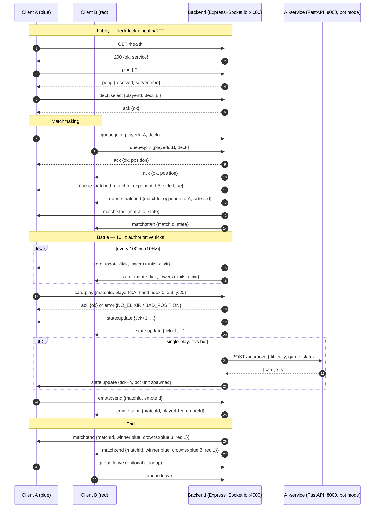

# GAME_DESIGN — CR Clone Normative Spec (Phase 2)

> STATUS: **NORMATIVE** — source of truth for Phase 3+ (backend server, frontend client, AI service).
> Merged 2026-10-17 on `feature/phase-2-game-design` from `docs/DRAFT_CARDS.md` + `docs/DRAFT_ARENA.md` +
> `docs/DRAFT_PROTOCOL.md` (working files deleted after merge). All contradictions flagged in
> `docs/ISSUES_phase-2-design.md` (ISS-D2-001…015) and `docs/ISSUES_phase-2-protocol.md` (ISS-P2-001…007)
> are resolved below; remaining debt is logged in §13. Static consistency verified in
> `docs/TEST_REPORT_phase-2-design.md` (6/6 PASS).
> Must stay compatible with `shared/types.ts` (`Card`, `Tower`, `Unit`, `GameState`, `SocketEvents` + Phase-2
> additive `CardStats`, `DeployRequest`, `ServerTick`). Server is authoritative; on any disagreement server wins.

## 0. Locked constants (do not change without a `// BREAKING(phase-N)` note)

| Constant | Value | Owner section |
|----------|-------|---------------|
| Arena grid | **18 cols (x 0–17) × 32 rows (y 0–31)** tiles, 1 tile = 1 unit, origin `(0,0)` top-left (Blue), center `(8.5, 15.5)` | §5 |
| Towers | **Princess 1400 HP**, **King 2400 HP** (1 king + 2 princess per side, 6 total) | §6 |
| Tower DPS | Princess 90 dmg / 0.8 s = **112.5 DPS** (range 7.5); King 100 dmg / 1.0 s = **100 DPS** (range 7.0) | §6 |
| Match clock | **180 s regulation** (3:00), double-elixir last 60 s (`t = 120–180 s`); **60 s sudden-death OT**, hard cap **240 s** | §8 |
| Elixir | Start **5**, cap **10**; **1 per 2.8 s** single (≈0.357/s), **1 per 1.4 s** double (≈0.714/s); full-match budget ≈ **90** | §7 |
| Tick | **10 Hz** authoritative server (`dt = 100 ms`), full `GameState` snapshot per tick; client renders **60 fps** interp | §9 |
| Canonical snapshot event | **`state:update`** (never `match:state`; see legacy dual-emit note §9/§12) | §9, §12 |
| Card pool | **12 cards**, elixir **1–6**; deck = exactly **8 distinct**, max **2 spells** | §1, §4 |
| Wire | JSON only, times are `number` ms; `pong.serverTime ≡ serverTimeMs` semantically | §12 |

---

## 1. Card list (12 cards, elixir 1–6)

All stats at tournament baseline (Level 9 equivalent). `dps` = damage / hit-speed.
`range` in tiles (1 tile = 1 arena unit; melee = ≤1.2). Crown-tower damage = 40% of full spell damage.
Tower reference (normative, owned by §6): Princess 1400 HP / 112.5 DPS, King 2400 HP / **100 DPS**
(fixes ISS-D2-003: cards-draft "king dps ~130" assumption discarded; arena 100 DPS is canonical —
slower king is comeback-friendly and matches the 24 s King-vs-King TTK in §6.1).

| # | Card | Type | Elixir | HP (total) | Dmg/hit | Hit speed | DPS | Speed | Range | Targets | Count | Rarity | Notes |
|---|------|------|--------|------------|---------|-----------|-----|-------|-------|---------|-------|--------|-------|
| 1 | Knight | troop | 3 | 1450 | 165 | 1.1s | 150 | med (0.9 t/s) | melee 0.8 | ground | 1 | common | Mini-tank, stable opener |
| 2 | Archers | troop | 3 | 300 x2 = 600 | 95 | 1.1s | 86 each / 172 total | med (0.9 t/s) | ranged 5.5 | air + ground | 2 | common | **Survive full Zap (300 > 220)**; die to Arrows/Fireball. Tie Cannon range 5.5 — win with tower help / first-shot (see §6.4) |
| 3 | Giant | troop | 5 | 3400 | 210 | 1.5s | 140 | slow (0.6 t/s) | melee 0.8 | buildings only | 1 | rare | Win-condition tank, ignores troops |
| 4 | Skeletons | troop | 1 | 80 x3 = 240 | 80 | 1.0s | 80 each / 240 total | fast (1.2 t/s) | melee 0.6 | ground | 3 | common | Cycle + Mini P.E.K.K.A bait; dies to any splash |
| 5 | Musketeer | troop | 4 | 600 | 200 | 1.0s | 200 | med (0.9 t/s) | ranged 6.0 | air + ground | 1 | rare | Highest single-target ranged dps; dies to Fireball |
| 6 | Baby Dragon | troop | 4 | 1100 | 150 splash | 1.6s | 94 splash | fast (1.1 t/s) | ranged 3.5 | air + ground | 1 | epic | Only flying splash; counter to Skeletons/Archers |
| 7 | Mini P.E.K.K.A | troop | 4 | 1100 | 550 | 1.6s | 344 | fast (1.2 t/s) | melee 0.8 | ground | 1 | rare | Glass cannon; hard-counters Giant/Golem 1v1 |
| 8 | Rock Golem (Golem-substitute) | troop | 6 | 4300 | 260 | 2.0s | 130 | slow (0.5 t/s) | melee 0.8 | buildings only | 1 (+ death burst 280 area 2.0) | epic | Late-game win-con; weak to swarm + kiting |
| 9 | Fireball | spell | 4 | — | 700 (280 vs towers) | travel 0.8s | — | — | cast anywhere, radius 2.5 | air + ground + towers | — | rare | **One-shots Musketeer (600) and Archers (300)** — intended premium answer at 4 elixir |
| 10 | Arrows | spell | 3 | — | 300 total (120 vs towers, 3 volleys x100) | 0.6s duration | — | — | cast anywhere, radius 4.0 | air + ground + towers | — | common | Kills Skeletons; kills Archers (300 = 300); weak vs Knight+ |
| 11 | Zap | spell | 2 | — | 220 (88 vs towers) + 0.5s stun | instant | — | — | cast anywhere, radius 2.5 | air + ground + towers | — | common | Resets/retargets; kills Skeletons; **does NOT one-shot full-HP Archers (300 > 220)** — needs tower/logic follow-up |
| 12 | Cannon | building | 3 | 750 | 210 | 0.8s | 262 | — (static) | ranged 5.5 | ground only | 1 | common | Lifetime 30s, deploy 1.0s; pulls Giant/Golem, dies to air |

Fix notes (ISS-D2-001, ISS-D2-010, ISS-D2-012): row 2 no longer claims "Dies to Zap" (220 < 300 — Archers
survive); row 9 drops the self-contradicting "never one-shots … = kills" clause (700 > 600 kills Musketeer,
intended); row 2 no longer claims "outranges Cannon" — both are range 5.5, it is a tie broken per §6.4.

### 1.1 Per-card detail (machine-readable summary)

- `knight { elixir:3, hp:1450, dps:150, speed:med, range:melee, targets:ground, count:1, rarity:common }`
- `archers { elixir:3, hp:300x2, dps:86x2, speed:med, range:ranged(5.5), targets:air+ground, count:2, rarity:common }`
- `giant { elixir:5, hp:3400, dps:140, speed:slow, range:melee, targets:buildings, count:1, rarity:rare }`
- `skeletons { elixir:1, hp:80x3, dps:80x3, speed:fast, range:melee, targets:ground, count:3, rarity:common }`
- `musketeer { elixir:4, hp:600, dps:200, speed:med, range:ranged(6.0), targets:air+ground, count:1, rarity:rare }`
- `baby-dragon { elixir:4, hp:1100, dps:94(splash), speed:fast, range:ranged(3.5), targets:air+ground, count:1, rarity:epic }`
- `mini-pekka { elixir:4, hp:1100, dps:344, speed:fast, range:melee, targets:ground, count:1, rarity:rare }`
- `rock-golem { elixir:6, hp:4300, dps:130(+280 death), speed:slow, range:melee, targets:buildings, count:1, rarity:epic }`
- `fireball { elixir:4, dmg:700/280-tower, radius:2.5, targets:all, rarity:rare }`
- `arrows { elixir:3, dmg:300/120-tower, radius:4.0, targets:all, rarity:common }`
- `zap { elixir:2, dmg:220/88-tower+stun0.5s, radius:2.5, targets:all, rarity:common }`
- `cannon { elixir:3, hp:750, dps:262, range:5.5, targets:ground, lifetime:30s, rarity:common }`

Each row maps to `shared/types.ts:Card` (`id,name,type,elixirCost,rarity,damage,hitPoints,range,radius,count,durationMs`)
plus the additive `CardStats` block (`speed/hit-speed/targets/sightRange/lifetime/deploy/stun/death-burst`;
`lifetime→durationMs`, stun/death-burst→new optional fields — fixes ISS-D2-007; see §12.3).

### 1.2 Playability check (3-min + double-elixir)

- Average cost of 12-card pool = 42/12 = 3.5. Starter deck avg should be 3.0-4.0.
- Kill-time sanity: Musketeer (200 dps) kills Knight (1450) in 7.3s; Mini P.E.K.K.A (344) kills Giant (3400)
  in 9.9s but Giant walks bridge→princess in **≈14–15 s** (9 tiles / 0.6 t/s — fixes ISS-D2-004, was "~10 s"),
  so an unsupported Giant arrives at ~half HP against 112.5 tower DPS and trades ~1–2 tower hits —
  supported Giant takes tower. Intended (wrong number fixed, design intent kept and strengthened).
- Fireball (700) one-shots Musketeer (600) and Archers (300) — intended premium answer at 4 elixir;
  Arrows (300) one-shots Skeletons and borderline Archers (300 = 300) but not Musketeer — intended ladder.
- Cannon (262 dps, 750 HP) stalls Giant (140 dps) for ~5.4s while dealing ~1400 — plus tower help kills Giant
  for +2 trade. Intended defensive value at 3 elixir.

---

## 2. Balance table (starting targets, all within 0.45–0.55 ship band)

> These are STARTING targets for `ai-service` balance analytics (Phase 6), not measured data.
> `GET /balance/cards?card=<id>` returns target win/pick below until replays exist.

| Card | Target win rate (mirror-adjusted) | Target pick rate (of decks containing) | Elixir-efficiency guardrail |
|------|-----------------------------------|----------------------------------------|------------------------------|
| Knight | 0.50 +/- 0.03 | 0.30-0.50 | If win > 0.55 for 2 patches: -100 HP |
| Archers | 0.50 +/- 0.03 | 0.25-0.45 | If pick < 0.15: +25 HP (survive Arrows edge) — revert if win > 0.53 |
| Giant | 0.50 +/- 0.03 | 0.20-0.35 | If win > 0.55: +1s deploy delay or -200 HP |
| Skeletons | 0.49 +/- 0.04 | 0.20-0.40 | If win < 0.45: count 3->4 at same HP |
| Musketeer | 0.51 +/- 0.03 | 0.25-0.40 | If win > 0.55: -40 HP (dies to Knight+Zap) |
| Baby Dragon | 0.50 +/- 0.03 | 0.15-0.30 | If pick < 0.12: +50 HP |
| Mini P.E.K.K.A | 0.50 +/- 0.03 | 0.20-0.35 | If win > 0.55: -50 damage (550->500) |
| Rock Golem | **0.49 +/- 0.03** | 0.12-0.25 | 6-cost risk: if win < 0.45: -1 elixir is FORBIDDEN (would break curve); instead +300 HP |
| Fireball | 0.51 +/- 0.03 | 0.25-0.40 | If win > 0.55: -50 damage |
| Arrows | 0.49 +/- 0.03 | 0.15-0.30 | If pick < 0.10: radius 4.0->4.5 |
| Zap | 0.50 +/- 0.03 | 0.25-0.45 | If win > 0.55: remove stun vs towers only |
| Cannon | 0.50 +/- 0.03 | 0.15-0.30 | If win < 0.45: +100 HP |

Global rule: no card may ship a patch with measured win < 0.45 or > 0.55; auto-flag to `ai-service /balance` + human review.
(Fixes ISS-D2-011: Golem tightened 0.48±0.04 → 0.49±0.03 so its target interval no longer dips below the 0.45 ban line.)

---

## 3. Counters

Every threat has a cheap answer and every answer is punishable: Giant/Rock Golem (building-targeting tanks)
are kited by Cannon (+ tower) and shredded 1v1 by Mini P.E.K.K.A, but Mini P.E.K.K.A is swarmed by Skeletons
and outranged by Archers/Musketeer; Archers/Musketeer win ranged trades but die to Fireball (premium) or
Arrows+Baby Dragon splash (cheap if pre-placed); Baby Dragon (only flying splash) beats all swarms but loses
to Musketeer 1v1 (200 dps vs 1100 HP = 5.5s vs 150-dmg/1.6s vs 600 HP = 6.4s — Musketeer wins with tower help,
loses alone vs Knight escort); Knight is the neutral stabilizer — beats Mini P.E.K.K.A with tower help, loses
elixir-neutral to Musketeer at range, trades up when shielding Giant/Golem; Cannon stops ground tanks but is
dead weight vs Baby Dragon/air and dies to Fireball/Zap chip; spells are capped at 2/deck so no spell-cycle
deck can dodge interaction — bringing 2 spells means dropping a hard answer elsewhere.

---

## 4. Deck-construction rule (normative)

- Deck = exactly 8 distinct cards from the 12 above.
- Max 2 spells per deck (Fireball, Arrows, Zap count as spells; Cannon is a building, not a spell).
- Average elixir SHOULD be 2.8–4.2 (client warns outside; server allows any 8 but matchmaking pairs similar
  avg in Phase 3+).
- Example starter decks (both legal):
  - Balanced: Knight, Archers, Musketeer, Baby Dragon, Giant, Skeletons, Fireball, Cannon
    (3+3+4+4+5+1+4+3 = 27, avg **3.375** — fixes ISS-D2-002, was "3.25").
  - Heavy: Rock Golem, Giant, Mini P.E.K.K.A, Knight, Archers, Musketeer, Zap, Cannon
    (6+5+4+3+3+4+2+3 = 30, avg 3.75, 1 spell).
- Server validates `deck.length == 8 && spells <= 2` in Phase 3 (`error:game INVALID_DECK` / `BAD_DECK`).

---

## 5. Arena geometry — 18 × 32 tiles, river, 2 lanes

### 5.1 Dimensions & coordinate system

- Grid: **18 columns (x: 0–17) × 32 rows (y: 0–31)** tiles. 1 tile = 1 arena unit.
- Origin `(0,0)` = top-left (Blue / Player 1 side). `(17,31)` = bottom-right (Red / Player 2 side).
- Center: `(8.5, 15.5)`. Vertical symmetry axis at `x = 8.5`.
- Orientation: portrait. Each half = 18×15 tiles plus 18×2 river band.
- `shared/types.ts:Vec2` mapping: `{ x: float tile, y: float tile }`. All positions authoritative as floats;
  rendering snaps to pixels.

### 5.2 River + bridges + lanes

- River: horizontal band **rows y = 15–16 inclusive** (2 tiles tall), full width `x = 0–17`, impassable except
  at bridges.
- Bridges: **2 lanes**, each 2 tiles wide:
  - Left bridge: `x = 3–4`, `y = 15–16`.
  - Right bridge: `x = 13–14`, `y = 15–16`.
- Lanes: left lane centered `x = 3.5`, right lane centered `x = 13.5`. Troops path to nearest bridge by x-side
  unless pulled by targeting (no knockback in Phase 2).
- River has no combat effect (no slow/buff). Flying troops cross anywhere over river; ground troops must use
  a bridge tile.

### 5.3 Deploy zones

- Normal time: own half only.
  - Blue deploys `y = 0–14` (own side of river, inclusive of own tower rows).
  - Red deploys `y = 17–31`.
- Cannot deploy on river (`y = 15–16`), on enemy half, inside tower footprint (1×1 exclusion radius, see §6.3),
  or on bridges occupied by enemy tower range indicator (allowed — no extra rule).
- Pocket rule (after destroying an enemy princess tower): deploy zone extends **4 tiles** into the enemy half
  on that lane side (`x < 9` for left bridge, `x >= 9` for right bridge; Blue pocket `y = 17–20`, Red pocket
  `y = 11–14` on the taken side). (Fixes ISS-D2-006: single number locked at **4 tiles**; the contradictory
  "± 8 tiles" clause is deleted. Server validation implements 4 tiles only.)
- Placement validation is server-side (§11).

### 5.4 Tower positions (tile centers)

| Tower | Owner | Tile center (x, y) |
|-------|-------|--------------------|
| King Blue | P1 | (8.5, 3.5) |
| Princess Left Blue | P1 | (3.5, 6.5) |
| Princess Right Blue | P1 | (13.5, 6.5) |
| King Red | P2 | (8.5, 27.5) |
| Princess Left Red | P2 | (3.5, 24.5) |
| Princess Right Red | P2 | (13.5, 24.5) |

- All towers occupy 1×1 tile footprint for deployment blocking; combat range measured radially from center.

---

## 6. Towers — 2× Princess 1400 HP + King 2400 HP + activation

### 6.1 Stats (Phase 2 starting numbers)

| Tower | HP | Damage / shot | Hit speed | Range (tiles) | Sight / acquire | Targets |
|-------|----|---------------|-----------|---------------|-----------------|---------|
| Princess (×2 per side) | **1400** | 90 | 0.8 s | 7.5 | 7.5 (same) | ground + air |
| King (×1 per side) | **2400** | 100 | 1.0 s | 7.0 | 7.0 when active | ground + air |

- Single-target projectiles, no splash. No elixir cost. Cannot be healed/buffed in Phase 2.
- Time-to-kill reference: Princess (1400 / 90-per-0.8s = 112.5 DPS) ≈ **12.4 s** unopposed;
  King (2400 / 100-per-1.0s = **100 DPS**) ≈ **24 s** unopposed.
  (Fixes ISS-D2-003: King DPS locked at **100**, TTK 24 s noted; the 130-DPS assumption is void.)
  Intended: towers defend but fall to sustained pushes.
- Tower ranges (7.5 / 7.0) outrange every troop (max 6.0 Musketeer), so troops always eat at least one tower
  shot on approach — intended, stated here (see ISS-D2-012).

### 6.2 King activation rule

- King tower starts **INACTIVE** (no attack, but still has HP and can be damaged).
- Activates (permanently) when EITHER:
  1. King takes any damage (spell, troop, tower shot), OR
  2. Any friendly princess tower is destroyed.
- Inactive king still grants crown if destroyed (§8) and still ends game if sniped (king-snipe = instant win).
- Rationale: prevents turn-1 king snipes from dominating; preserves comeback via central defense once active.

### 6.3 Targeting

- Towers acquire nearest enemy unit in range (Euclidean, tiles). No re-target delay beyond hit-speed cooldown.
- Princess towers prioritize units in own lane quadrant but fall back to nearest-in-range (no hard lane lock).
- King, once active, behaves identically to princess with its own stats/range.
- Buildings (Cannon) pull tower aggro per standard troop rules: tower targets closest enemy entity, troops
  target tower if no troops in their sight range.
- **Inactive king aggro (fixes ISS-D2-013):** troops target an inactive king normally when it is nearest in
  their sight range (no immunity); inactivity only suppresses the king's own attacks until triggered.
  Consequence: a central leak can end the game — king-snipe is instant win per §8.1.

### 6.4 Range-tie & same-tick order (fixes ISS-D2-012)

- Archers (5.5) vs Cannon (5.5) is a **tie**, not outrange — Archers win only with tower help / first-shot.
- Same-tick resolution order is locked: **tower shots resolve before troop shots within a tick**; remaining
  ties broken by lower `tickId`, then lower entity id. Deterministic across server and replays.

### 6.5 Tower shots are hitscan (fixes ISS-D2-015)

- Tower damage applies **on the firing tick**; the "projectile" is a client visual only.
- `GameState`/`ServerTick` therefore carries **no projectile array** in Phase 2 — snapshots stay small (§9).
  If travel-time is wanted later, add an optional `projectiles?` array additively and re-cost the 10 Hz budget.

---

## 7. Elixir — 1 per 2.8 s, 1 per 1.4 s double-time, max 10

- Cap: **10 elixir**. Overflow is lost (no banking past 10).
- Start: **5 elixir** for both players at `t = 0`.
- Regen (authoritative, server tick-accumulated as float, displayed floored + partial bar):
  - Single time (`t = 0–120 s` and overtime if not double — see §8): **1 elixir per 2.8 s** (≈ 0.357 elixir/s).
  - Double time (last 60 s of regulation, `t = 120–180 s`, AND all of overtime): **1 elixir per 1.4 s**
    (≈ 0.714 elixir/s).
- Passive only. No elixir from kills/towers in Phase 2.
- **Wire type (fixes ISS-D2-014):** `state:update.elixir` carries the **server float (0–10)**;
  clients floor for display only and never send elixir back (client-sent cost ignored per §11.1).

### 7.1 Economy vs 12-card / avg 3.5 assumption

- Assumed deck avg **3.5 elixir** (12-card pool; 4-card hand + next-card queue).
- Single-time income: 60 / 2.8 ≈ **21.4 elixir/min** ≈ **6.1 avg-cards/min**.
- Double-time income: 60 / 1.4 ≈ **42.8 elixir/min** ≈ **12.2 avg-cards/min**.
- Full-match budget (3 min regulation = 2 min single + 1 min double): 5 (start) + 2×21.4 + 42.8 ≈ **~90 elixir**
  ≈ ~25 avg plays. Plus overtime 60 s double (+42.8) if drawn.
- Design intent: single time = one 3–4 elixir play per ~10 s; double time = trade-for-trade + spell cycles;
  cap 10 punishes hoarding and rewards pre-double pushes. Consistent with 3–5 elixir troops and 2–6 elixir
  spells/buildings in the 12-card set — no card exceeds 6 elixir so a full bar always affords any single play.

---

## 8. Match clock — 3 min + 60 s overtime sudden-death; win / crowns / draw

### 8.1 Clock

- Regulation: **180 s (3:00)**.
- Double-elixir window: last 60 s of regulation (`t = 120–180 s`).
- Overtime (only if tied — see §8.2): **60 s**, double elixir rate, **sudden-death**: first tower destruction
  (any princess or king) ends match immediately.
- Hard cap: match ends at `t = 240 s` at latest.

### 8.2 Crowns & win

- Crowns: 1 per enemy princess destroyed, **3 for king** (king destruction also ends match instantly —
  king-snipe = instant win regardless of clock/crowns).
- Win priority at any stoppage (`t = 180 s`, overtime first-blood, or `t = 240 s`):
  1. King destroyed → destroyer wins immediately (3 crowns ceremonial).
  2. Else higher crowns wins.
  3. Else (crowns tied) → the player whose **enemy's weakest standing tower has the lower HP%** wins.
     Tiebreak set = **all remaining (standing) towers, king included** (king-chip counts — king-chip is not
     free). Destroyed towers are excluded (not counted as 0%).
  4. Else (identical crowns AND tiebreak within epsilon) → **draw**.
- **Overtime trigger (fixes ISS-D2-009):** OT iff crowns are tied AND |Δ lowest-tower-HP%| ≤ **0.5% epsilon**
  at `t = 180 s`; otherwise the HP% leader wins at 180 s with no overtime. Consequence: a chipped 0–0
  (e.g. 1399/1400 vs 1400/1400, Δ ≈ 0.07% ≤ 0.5%) still goes to sudden-death OT; a clearly damaged 0–0
  (e.g. 1000/1400 vs 1400/1400) ends at 180 s on chip — intended (rewards chip), stated here.
- No extra tiebreakers (damage dealt, elixir spent) in Phase 2 — draw stands, both players get draw result
  for leaderboard/MMR stub.
- Sudden-death overtime: next tower kill wins; if zero kills by `t = 240 s`, apply rule 3–4 above
  (crowns then HP% then draw).

### 8.3 Examples

- 1–0 crowns at 3:00 → 1-crown player wins, no overtime.
- 1–1 at 3:00, lowest towers 600/1400 (42.9%) vs 900/1400 (64.3%) → first player wins (opponent more damaged).
- 0–0 at 3:00, all towers full → 60 s overtime; first princess kill wins; 0–0 at 4:00 with equal chip → draw.
- 0–0 at 3:00, towers 1000/1400 (71.4%) vs 1400/1400 (100%), Δ = 28.6% > 0.5% → chip leader wins at 180 s,
  **no overtime** (new chipped-0–0 example per ISS-D2-009).

---

## 9. Authoritative tick — 10 Hz server, 60 fps client interpolation

- Server: **authoritative fixed tick 10 Hz** (`dt = 100 ms`). All movement, combat, elixir, tower HP, deploy
  validation resolved on tick. `dt` fixed (no variable-step physics).
- Snapshot broadcast: full `GameState` (per `shared/types.ts:GameState`, alias `ServerTick`) at **10 Hz** over
  Socket.io **`state:update`** (fixes ISS-D2-005: the arena-draft `match:state` name is void —
  **never emit `match:state`**). Delta compression is Phase 5+; Phase 2 sends full snapshot (arena is small).
- **Legacy dual-emit note:** Phase 3 server emits the canonical `state:update` AND keeps the Phase-1 stub
  aliases on their twins where defined (`queue:matched` + `match:found`, `error` + `error:game` with identical
  payload) until a `// BREAKING(phase-3)` cleanup removes the stubs. `state:update` itself has no twin —
  it IS the stub name, kept canonical.
- Client: renders at **60 fps** (Canvas, Phase 5), interpolating entity positions between last two snapshots
  (linear interp, 100 ms buffer). HP/elixir/timer snap (no interp). Client predicts NOTHING authoritative —
  placement ghost only.
- Server EXE order per tick: (1) consume validated actions, (2) regen elixir, (3) move units,
  (4) acquire targets + resolve combat (tower shots before troop shots, §6.4), (5) check tower destruction /
  king activation / win, (6) broadcast.
- Clock source: server tick count (`tick`, `serverTimeMs`). Client timer displays `serverTimeMs`, never local
  clock.
- Snapshot budget (fixes ISS-P2-003): p95 tick **≤ 4 KB JSON**; live `units` cap **N = 40** (truncate/summarize
  beyond cap, never drop towers); future delta compression allowed additively. Tester logs
  `JSON.stringify(state).length` over a 60 s bot game at 10 Hz.

---

## 10. Lag / compensation note

- Expected path: 10 Hz snapshots + 100 ms interp buffer absorb jitter ≤ ~150 ms with no visible teleport.
  Input (card play) latency ≈ RTT/2 + ≤100 ms to next tick — acceptable for card battler (no twitch aiming).
- No client-side prediction or server rewind in Phase 2 (troop speeds ≤ ~1.5 tiles/s; 200 ms lag ≈ 0.3 tile
  error — negligible).
- Jitter handling (client, Phase 5): adaptive interp delay (100–250 ms); if snapshot gap > 300 ms, extrapolate
  last velocity ≤ 200 ms then freeze (no speculative kills).
- Reconnect: client re-requests latest snapshot (`match:sync`); server keeps full state in memory + Redis
  ephemeral (Phase 3 wiring). No pause on disconnect in Phase 2 (match continues).
- Anti-speedhack corollary: server ignores client `dt`; movement integrated only with server `dt = 100 ms`.
- Clock combine rule (fixes ISS-P2-005): all times are `Date.now()` ms; `pong.serverTime ≡ serverTimeMs`
  semantically — client RTT/offset math may use either key interchangeably. Phase 3 MAY add a `serverTimeMs`
  alias to `pong` additively; `serverTime` is never renamed until `// BREAKING(phase-3)`.

---

## 11. Anti-cheat — server validates elixir + positions (+ clock)

Authoritative server NEVER trusts client for:

1. **Elixir**: cost checked against server-side elixir float at tick; insufficient → reject `card:play` with
   `NO_ELIXIR` (ack `ok:false` + `error`/`error:game` twin); costs from server card table only (client-sent
   cost ignored).
2. **Positions**: deploy point inside caller's legal deploy zone (§5.3) at server tick — per-side own-half
   mapping: Blue troops `y 0–14` (pocket `y ≤ 20` on taken side), Red troops `y 17–31` (pocket `y ≥ 11` on
   taken side); spells (Fireball/Arrows/Zap) may target anywhere `x [0,18] y [0,32]`. Inside-tower-footprint /
   river / enemy-half (absent pocket) → reject `BAD_POSITION`, no state mutation, no clamp
   (fixes ISS-P2-006: half-split, per-side mapping, spell allow-list, reject-vs-clamp all locked here).
3. **Cooldowns/hand**: card must be in player's current 4-card hand + next-queue per server deck state;
   wrong card/double-spend same tick → reject `BAD_HAND_INDEX` / `CARD_REJECTED`. One action per card-slot
   per tick max.
4. **Clock/rate**: timestamp must be within ±5 ticks of server tick (`|clientTick − serverTick| > 5` →
   `STALE_TICK`, server wins); burst cap 5 `card:play`/s/side sustained, flooded actions → throttle +
   `RATE_LIMITED`; emote 1/5 s (fixes ISS-P2-007: stale window, burst cap, emote limit locked here).
5. **Match access**: socket must be authenticated match participant (or spectator read-only); cross-match
   actions rejected.

- Deck rules (fixes ISS-P2-007): 8 distinct ids from the §1 list, no duplicates at all in Phase 2
  ("no duplicates beyond allowed" = none allowed); violation → `BAD_DECK`. Legacy `match:join` alias ignores
  `matchId` and is treated as `queue:join` (same ack shape).
- All rejections are logged with `tick`, `playerId`, reason; client surfaces toast + refunds nothing
  (no elixir deducted on reject).
- Ack-vs-event rule (fixes ISS-P2-004): synchronous validation → ack
  (`Ack = { ok: boolean; position?: number; error?: { code, message } }`); async/broadcast failures →
  `error` + `error:game` twins with **identical** `{ code, message, matchId? }` (`matchId?` added to the legacy
  twin additively). Client rule: toast on `error`, reconcile on next `state:update` (truth, no desync).
- Replay/audit (Phase 6 hook): every accepted action appended to match event log for `ai-service` balance
  analytics.

---

## 12. Protocol — Socket.io + REST + sequence

Transport: Socket.io v4 on backend port `4000`, path default `/socket.io/`. CORS `*` in stub.
Base URLs: backend `http://localhost:4000`, AI `http://localhost:8000`, frontend `http://localhost:3000`.
Auth stub: `playerId: string` (opaque; real auth Phase 7). All payloads JSON-serializable only.
Existing wire names keep working (additive only): `GET /health`, `ping→pong`, `emote:send`, `state:update`,
`match:end`, `error:game`.

### 12.1 Client → server

#### `queue:join` — request matchmaking

```ts
{ playerId: string; deck: string[]; } // deck: 8x Card.id, e.g. ["knight","archers",...]
```

- Validation: `deck.length === 8`, all ids known from §1, no duplicates (see §11).
- Server: adds to FIFO, returns ack `{ ok, position }`. When pair found → `queue:matched` to both.
- Legacy alias: `match:join` still accepted (requires `matchId`; server ignores it and treats as `queue:join`).

#### `queue:leave` — leave matchmaking

```ts
{ playerId: string; }
```

- Idempotent. Ack `{ ok }` even if not queued.

#### `deck:select` — lock/select deck pre-queue (lobby/deck-builder Phase 4)

```ts
{ playerId: string; deck: string[]; } // 8 ids
```

- Validation: same as `queue:join`. Persists to in-memory + later Postgres (Phase 7).
- May be folded into `queue:join`; kept separate so deck-builder can validate without queueing.

#### `card:play { handIndex, x, y }` — core gameplay intent (10 Hz tick validates and applies)

```ts
{
  matchId: string;
  playerId: string;
  handIndex: number; // 0..3 current hand slot
  x: number; y: number; // arena units, x in [0,18], y in [0,32]
  cardId?: string; // OPTIONAL back-compat echo of Card.id; server resolves via handIndex, mismatch → CARD_REJECTED
  at?: { x: number; y: number }; // OPTIONAL back-compat alias for x/y
  clientTick?: number; // OPTIONAL, for stale rejection (|Δ| > 5 → STALE_TICK)
}
```

- Canonical shape is `DeployRequest` (§12.3). Validation per §11 (match live, side owns turn, handIndex in
  range, position per §5.3, elixir ≥ cost, cooldown ok). Failure → ack `ok:false` + `error`/`error:game`
  twin (`CARD_REJECTED` family), no state mutation.
- Success: elixir deducted, next card cycled into hand, unit/spell spawned next tick.

#### `emote:send` — reserved cosmetic (Phase 5), kept verbatim

```ts
{ matchId: string; playerId: string; emoteId: string; }
```

- Rate-limited 1/5 s. Never affects simulation.

#### `ping` (existing, keep)

```ts
// client emits: any payload
// server replies pong:
{ received: unknown; serverTime: number; } // Date.now()
```

- Used for RTT + client clock offset for 60 fps interpolation. Do not remove. (`serverTime ≡ serverTimeMs`.)

### 12.2 Server → client

#### `queue:matched { matchId }`

```ts
{
  matchId: string;
  opponentId: string;
  side: PlayerSide; // 'blue' | 'red'
  serverTimeMs: number;
}
```

- Emitted to both queued sockets. Client then expects `match:start` + `state:update` stream.
- Legacy alias: also emit `match:found { matchId, opponentId }` with same `matchId`.

#### `state:update { tick, entities, elixir }` — 10 Hz (canonical snapshot)

Wire type ≡ existing `GameState` (`shared/types.ts`), alias `ServerTick`:

```ts
{
  matchId: string;
  tick: number; // monotonic, +1 per 100ms
  serverTimeMs: number;
  elixir: Record<PlayerSide, number>; // 0..10 server float (§7)
  towers: Tower[];   // 6 total: 1 king + 2 princess per side
  units: Unit[];     // live troops (cap 40, §9); spells resolved as instant effects
  crowns: Record<PlayerSide, number>;
  winner?: PlayerSide | 'draw';
  endsAtMs?: number;
}
```

- Frequency: `10 Hz` (every 100 ms). `tick` + `serverTimeMs` drive client interpolation.
- `entities` shorthand = `towers + units` above. No field renamed; new entity arrays only additively
  (e.g. `projectiles?` if travel-time ever lands, §6.5).
- First snapshot optionally preceded by `match:start { matchId, state }` for lobby transition (retained).

#### `match:end { winner, crowns }`

```ts
{
  matchId: string;
  winner: PlayerSide | 'draw';
  crowns: Record<PlayerSide, number>;
}
```

- Terminal. Server stops tick, persists result (Phase 7). Client shows result screen, returns to lobby.

#### `error` / `error:game` (twin-emit until Phase 3 cleanup)

```ts
{ code: string; message: string; matchId?: string; }
```

- Codes: `BAD_DECK`, `NOT_QUEUED`, `BAD_HAND_INDEX`, `NO_ELIXIR`, `BAD_POSITION`, `CARD_REJECTED`,
  `STALE_TICK`, `RATE_LIMITED`.
- Emit on both `error` (new) and `error:game` (legacy) with identical payload until Phase 3 cleanup.

### 12.3 `shared/types.ts` additions (additive only — normative)

> Rule: additive only. Never rename/remove `Card/Tower/Unit/GameState/SocketEvents` fields. New interfaces +
> optional fields + new event keys only. Wire names `health`, `ping/pong`, `emote:send` unchanged.
> (Fixes ISS-P2-001: the `card:play` refinement uses `Omit` + intersection — a bare `extends` with a
> conflicting key would fail `tsc --noEmit` and is forbidden.)

```ts
// --- Card stats (fills Phase-1 stub optionals with a normative block; fixes ISS-D2-007) ---
export interface CardStats {
  hitPoints: number;
  damage: number;
  dps?: number;       // damage / hitSpeed convenience
  range: number;      // tiles; melee ≈ 0.8-1.2
  sightRange: number; // aggro distance
  moveSpeed: number;  // tiles/sec
  hitSpeed: number;   // sec per attack
  elixirCost?: number;
  radius?: number;    // splash / spawn radius
  count?: number;     // troops spawned
  durationMs?: number;// spells/buildings (Cannon lifetime 30s lives here)
  targets?: 'ground' | 'air+ground' | 'buildings';
  stunMs?: number;    // Zap 0.5s lives here
  deathBurst?: number;// Rock Golem 280 lives here
}

// Additive extension — all new fields optional so old imports still compile:
export interface CardWithStats extends Card {
  stats?: CardStats;
  elixirCost: number; // re-declared, still 1-10
  arena?: { minX: number; maxX: number; minY: number; maxY: number };
}

// --- Deploy intent (canonical shape for card:play payload) ---
export interface DeployRequest {
  matchId: string;
  playerId: string;
  handIndex: number; // 0..3
  x: number;         // [0,18]
  y: number;         // [0,32]
  cardId?: string;   // back-compat echo of Card.id
  at?: Vec2;         // back-compat alias for {x,y}
  clientTick?: number;// for server reconciliation / stale rejection
}

// --- Server tick snapshot (canonical state:update payload; goal shorthand resolved) ---
export interface ServerTick extends GameState {
  // tick     -> GameState.tick
  // entities -> GameState.towers + GameState.units
  // elixir   -> GameState.elixir
}
export type EntitiesSnapshot = Pick<GameState, 'towers' | 'units'>;

// --- Socket map extension (additive — every key in SocketEvents is kept) ---
export type CardPlayPayload = DeployRequest & { cardId?: string; at?: Vec2 };
export interface SocketEventsV2 extends Omit<SocketEvents, 'card:play' | 'state:update'> {
  // client -> server (new canonical)
  'queue:join': { playerId: string; deck: string[] };
  'queue:leave': { playerId: string };
  'deck:select': { playerId: string; deck: string[] };
  // server -> client (new canonical)
  'queue:matched': { matchId: string; opponentId: string; side: PlayerSide; serverTimeMs: number };
  'error': { code: string; message: string; matchId?: string };
  // refined payloads — DeployRequest is accepted wherever the legacy shape was
  'card:play': CardPlayPayload;
  'state:update': ServerTick;
  // ping/pong kept verbatim:
  //   'ping': unknown; 'pong': { received: unknown; serverTime: number }
}
export interface Ack { ok: boolean; position?: number; error?: { code: string; message: string }; }
```

Migration notes:
1. Phase 3 server listens on BOTH `queue:join` and `match:join`, emits BOTH `queue:matched` and
   `match:found`, emits `error` + `error:game` twins.
2. `card:play` handler accepts `DeployRequest & { cardId?, at? }`; resolves truth via `handIndex` →
   authoritative hand.
3. `ServerTick` introduces no new required fields — `entities` is doc shorthand, not a new wire field.
4. `CardStats` values live in the §1 tables; `Card` stub optionals stay until Phase 3 validation imports
   `CardStats`. `tsc --noEmit` must pass on `shared/` (regression guard for ISS-P2-001).

### 12.4 Bot-move gap (fixes ISS-P2-002)

- Stub `POST /bot/move` returns `{ card, x, y, difficulty }` (card NAME, no `handIndex`); canonical
  `card:play` requires `{ handIndex 0..3, x, y }`. Resolution locked here: the AI returns a **suggestion**
  `{ cardId?, handIndex?, x, y }`; the **server authoritative-resolves** via the bot's current hand
  (`handIndex` wins if present, else look up `cardId` in hand; neither found → `CARD_REJECTED`, no spawn).
  Phase 6 may add optional `handIndex?` to the stub response additively; the REST contract itself is unchanged.

### 12.5 REST

#### `GET /health` (exists — backend + ai-service)

- Backend `GET http://localhost:4000/health` → `200 { ok: true, service: "backend" }`.
- AI `GET http://localhost:8000/health` → `200 { ok: true, service: "ai" }`.
- Use for Docker Compose healthchecks, LB probes. No auth. Keep exact `{ ok, service }` shape.

#### `POST /bot/move` (exists — ai-service stub, Phase 6 full logic)

- `POST http://localhost:8000/bot/move` `Content-Type: application/json`.
- Request:

```json
{ "difficulty": "medium", "game_state": {} }
```

- Response:

```json
{ "card": "knight", "x": 9.1, "y": 20.4, "difficulty": "medium" }
```

- Behavior (stub): random `card ∈ ["knight","archers","giant","fireball","skeletons"]`, `x ∈ [0,18]`,
  `y ∈ [0,32]`, echo/normalize `difficulty ∈ easy|medium|hard` (default `medium`).
- Phase 6: accept full `GameState` in `game_state`, return legal suggestion per §12.4. REST contract unchanged
  (additive fields only).

#### `GET /balance/cards` (exists — stub analytics, Phase 6 real)

- `GET http://localhost:8000/balance/cards` → `200`:

```json
{
  "cards": [
    { "name": "knight", "win_rate": 0.5, "pick_rate": 0.2 }
  ],
  "note": "stub data — real analytics in Phase 6"
}
```

- Phase 6: compute from Postgres match history. Keep `{ cards: [{ name, win_rate, pick_rate }] }` shape; add
  fields additively. Until replays exist, serve the §2 target table.

### 12.6 Sequence diagram — match flow (join → matched → play ticks → end)



Error paths (any time): `S->>C: error {code, message, matchId?}` (+ legacy `error:game` twin with identical
payload). Client shows toast, does not desync — next `state:update` is truth.

### 12.7 Legacy → Phase-3 canonical event mapping

| Phase 1 stub (keep) | Phase 3 canonical (this spec) | Note |
|---|---|---|
| `match:join { matchId, playerId, deck }` | `queue:join { playerId, deck }` | queue entry has no `matchId` yet; alias ignores `matchId` |
| `match:leave { matchId, playerId }` | `queue:leave { playerId }` | same |
| — | `deck:select { playerId, deck }` | pre-queue deck lock |
| `card:play { matchId, playerId, cardId, at, handIndex }` | `card:play { matchId, playerId, handIndex, x, y }` + `cardId`/`at` optional | server resolves via `handIndex` |
| `match:found { matchId, opponentId }` | `queue:matched { matchId }` | same payload + `opponentId`, `side`, `serverTimeMs` |
| `match:start { matchId, state }` | kept as first `state:update` trigger | retained for lobby→battle transition |
| `state:update: GameState` | `state:update { tick, entities, elixir }` ≡ `GameState` | shape unchanged, tick snapshot; `match:state` never emitted |
| `match:end { matchId, winner, crowns }` | same | unchanged |
| `error:game { code, message }` | `error` alias `{ code, message, matchId? }` | wire both keys with identical payload until Phase 3 cleanup |
| `ping` → `pong` | kept as-is (latency/RTT probe) | do not rename |

---

## 13. Deferred / known issues (open design debt for Phase 3+)

- **Coverage depth (was ISS-D2-008, minor — accepted):** only ONE swarm (Skeletons ×3), ONE flier (Baby Dragon),
  ONE building (Cannon). Playable for a 12-card starter, but meta will solve fast. Phase 4+ adds ≥1 true
  horde, ≥1 air tank/harasser, ≥1 alt building. Watch pick-rate guardrails (§2: Cannon/Baby Dragon lower
  bounds) for early staleness signal.
- **Open tuning questions for playtest:** princess 1400 vs 1500 HP; king range 7.0 vs 7.5; double-time start at
  120 s vs 150 s — all flagged for `ai-service` balance endpoint, not decided here.
- **Delta compression** deferred to Phase 5+ (full snapshots until then, §9 budget enforced).
- **Real auth** deferred to Phase 7 (`playerId` opaque until then).

---

## Appendix A — merger fix log (reviewer issues → resolution in this file)

| ID | Severity | Resolution |
|----|----------|------------|
| ISS-D2-001 Archers/Zap contradiction | major | FIXED §1 rows 2+11: Archers (300) survive full Zap (220) |
| ISS-D2-002 deck avg 3.25 | minor | FIXED §4: 27/8 = **3.375** |
| ISS-D2-003 King DPS 130 vs 100 | major | FIXED §0/§1/§6.1: canonical **100 DPS**, TTK 24 s noted |
| ISS-D2-004 Giant ~10 s | major | FIXED §1.2: bridge→princess **≈14–15 s** |
| ISS-D2-005 `match:state` vs `state:update` | major | FIXED §9/§12: canonical **`state:update`**; `match:state` never emitted; dual-emit note kept |
| ISS-D2-006 pocket 8 vs 4 tiles | major | FIXED §5.3: locked **4 tiles** with exact y-bands per side |
| ISS-D2-007 stat fields homeless | major | FIXED §1.1/§12.3: additive `CardStats` adopted (`lifetime→durationMs`, `stunMs`, `deathBurst`) |
| ISS-D2-008 thin coverage | minor | DEFERRED §13 (ship the 12; Phase 4+ debt logged) |
| ISS-D2-009 OT tiebreak ambiguity | major | FIXED §8.2–8.3: standing-towers incl. king, 0.5% epsilon, chipped-0–0 example |
| ISS-D2-010 Fireball self-contradiction | minor | FIXED §1 row 9: one-shots Musketeer/Archers, intended |
| ISS-D2-011 Golem band dips below 0.45 | minor | FIXED §2: 0.49 ± 0.03 |
| ISS-D2-012 range-tie rule missing | minor | FIXED §1 row 2 + §6.4: tie declared, tower-first same-tick order locked |
| ISS-D2-013 inactive-king aggro | major | FIXED §6.3: troops target inactive king normally; inactivity suppresses only its attacks |
| ISS-D2-014 elixir float vs int | minor | FIXED §7 + §11.1: wire carries server float; display floors only |
| ISS-D2-015 tower projectiles model | minor | FIXED §6.5: hitscan on firing tick; visual-only projectile |
| ISS-P2-001 `extends` breaks on `card:play` | major | FIXED §12.3: `Omit` + `CardPlayPayload`; `tsc --noEmit` guard |
| ISS-P2-002 bot `card` vs `handIndex` gap | major | FIXED §12.4: AI suggests, server resolves (`handIndex` wins) |
| ISS-P2-003 no tick size budget | minor | FIXED §9: p95 ≤ 4 KB, units cap 40 |
| ISS-P2-004 ack vs `error` duplication | minor | FIXED §11: `Ack` type + ack-vs-event rule + identical twins |
| ISS-P2-005 `serverTime` vs `serverTimeMs` | minor | FIXED §10/§12: `pong.serverTime ≡ serverTimeMs` norm |
| ISS-P2-006 position validation half-split | minor | FIXED §11.2: per-side y-bands + spell allow-list + reject (no clamp) |
| ISS-P2-007 deck/dupe + stale/rate vague | minor | FIXED §11: no dupes, ±5-tick window, 5/s burst cap, emote 1/5 s |

*(End — GAME_DESIGN normative, Phase 2. Working drafts DRAFT_CARDS / DRAFT_ARENA / DRAFT_PROTOCOL deleted.)*
